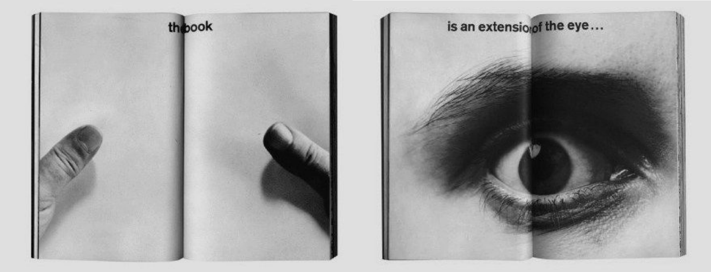

# Book of Rituals: the unit brief

The foundation of this repo. Everything else (`project/brief.md`, `expertise/`, the skills) is organised around it. Claude reads this before `project/brief.md`.

- **Unit:** Diploma Unit 12, Architectural Association
- **Term:** Term 1, 2026–2027, continuing through the year
- **Working file:** compiled and printed through Term 1, brought to tutorials
- **Edit:** weeks 8 and 9 of Term 1, the file becomes an edited book
- **Deadline:** Week 1, Term 2

*Marshall McLuhan, Quentin Fiore – The Medium is the Massage*

---

## The brief, as written

**Project Log**\
**Book of Rituals**\
Diploma Unit 12 – Term 1, 2026-2027\
Deadline: Week 1 Term 2

This year, you will be asked to create a book: the Book of Rituals. This book will be a project log in which you will compile all the evidence of the context, the conflict, the ritual, and the design process of your project, as well as your references.

The book should be organized in the following sections:

### 1) Context:

This section gives evidence on all relevant aspects of the context on which you will be working and must contain:

- **Who:** document through interviews, photo essays, graphic descriptions, etc. as required to thoroughly describe the social group or non-human entity you are addressing and include: a stakeholder diagram
- **What:** document through pictures, drawings, and other forms of evidence the architectures, objects, materials that define the reality of the site
- **Where:** document through site maps, photo essays, and other forms of evidence the location and geographic description of your site and include: scaled drawing(s) of site
- **When:** document through time-based visual representation, chronologies, text, and other forms of evidence the key historical facts and, if relevant, future predictions on your context and include: a timeline

• Audiovisual materials accompanying any of these sections must be evidenced in the book through still frames, transcriptions, etc.

### 2) Conflict:

This section gives evidence on all relevant aspects of the conflict you are addressing. It should reflect the relationship between the sacred and the profane with the conflict and must contain:

- **Why:** document through press cutouts, interviews, field work data, statistics, and any other relevant forms of evidence the power dynamics and frictions that generate the conflict, and include:

  - a) Title: evocative and catchy
  - b) Subtitle: descriptive and concise
  - c) Research question

  Format for the articulation of the research question:

  > In the context of… [include the where, the who],
  > how can I/this project….[include the what: practice technique/methodology]
  > to bring about …[describe the change you want to bring about].

  I.e.: In the context of AA diploma school, how can a teaching methodology transform the understanding of architectural practice.

  - d) short project statement\
    300 words expansion on research question, explaining the conflict and the urgency, unpacking the 5W, and highlighting the project strategy.

### 3) Rituals:

This section gives evidence on one ritual that makes visible the conflict, shows the ways in which sacred spaces and regimes are reinforced or profaned. It must contain:

- **Who:** document through interviews, photo essays, graphic descriptions, diagrams, historical documents, etc. who specifically enacts the ritual
- **What:** document through pictures, drawings, and other forms of evidence the technologies that enable the ritual
- **Where:** document through drawing, pictures, and other forms of evidence the exact location(s) in which the ritual happens
- **When:** document through time-based visual representation, chronologies, text, and other forms of evidence the temporal development of the ritual
- **Why:** document through first hand witnesses, field work data, interviews, and any other relevant forms of evidence the motivations/reasons behind the ritual

Must include: time based drawings

• This section of the book collects the materials correlating with the making of a film presenting the chosen ritual.

### 4) Expertise

- **Design:** This section compiles and documents through visual evidence:

  - a) design strategies, solutions and aesthetics
  - b) tectonic and material explorations
  - c) tools, fabrication processes
  - d) craft development

  Must include: resolution of a detail\
  • For 5th years this section will become your ETS document.

- **Theory and knowledge:** This section compiles and documents through text, image, and any other form of evidence, the expertise provided by individuals, collectives and any kind of experts from the institutional and academic to any forms of collective intelligence, lived experience and traditional or indigenous knowledge

- **Practice:** This section compiles references of practices that influence your own practice.

The book will be a tool to establish a working methodology and provide evidence of the project. The making of the book will start in Term 1 and continue throughout the year.

In Term 1, to begin making the book, you will be asked to compile all your evidence into a file. This file should contain all documents printed. It is a working tool and should be brought to tutorials regularly to facilitate discussion and contextualization of the project.

During weeks 8 and 9 of Term 1, time will be allocated to convert the initial file into an edited book. The book will then be further refined over the winter break and continue to expand over the following two semesters.

---

## In plain words

You make one book all year. It is the evidence for your project. It has four parts, and each one builds on the last.

1. **Context.** Who, what, where, when. Who are you designing for or with (people, or something non-human)? What is physically there? Where exactly is it? What happened there, and what might happen next? Three things are required: a **stakeholder diagram**, a **scaled site drawing**, a **timeline**.
2. **Conflict.** Why it matters: the power and friction at your site, and how it touches the sacred and the profane. Back it with evidence (press, interviews, field data, figures). You end this part with a **title**, a **subtitle**, a **research question** in the format above, and a **300-word statement**.
3. **Ritual.** One ritual that makes the conflict visible: who does it, with what, where, when, why. Required: **time-based drawings**. This part also holds the material for your **film** of the ritual.
4. **Expertise.** Three kinds:
   - **Design:** your strategies, materials, tools, fabrication and craft. Required: **one resolved detail**.
   - **Knowledge:** what experts of any kind know: academics and institutions, but also collectives, lived experience, traditional and indigenous knowledge.
   - **Practice:** the practices that shape how you work.

   **Activate it:** contact one expert, contact one institution, order one book.

**Format.** In Term 1 it is a file of printed evidence you bring to every tutorial. In weeks 8 and 9 it becomes an edited book. You refine it over the winter break, hand it in at Week 1 of Term 2, and keep adding to it for the rest of the year. Film and audio go in as stills and transcripts.

**Where each part lives in this repo:** the table "Where things go" in `CLAUDE.md`.

## ETS

**Term 2, 5th years only.** The Design part of Expertise becomes your ETS document. Nothing to do for it yet; keep the design evidence in `project/design/` well labelled so it can be lifted out later.
